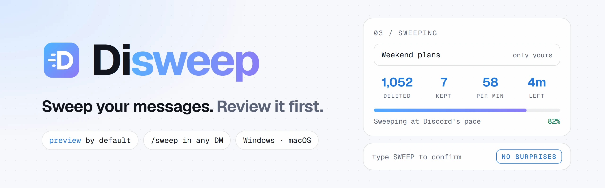
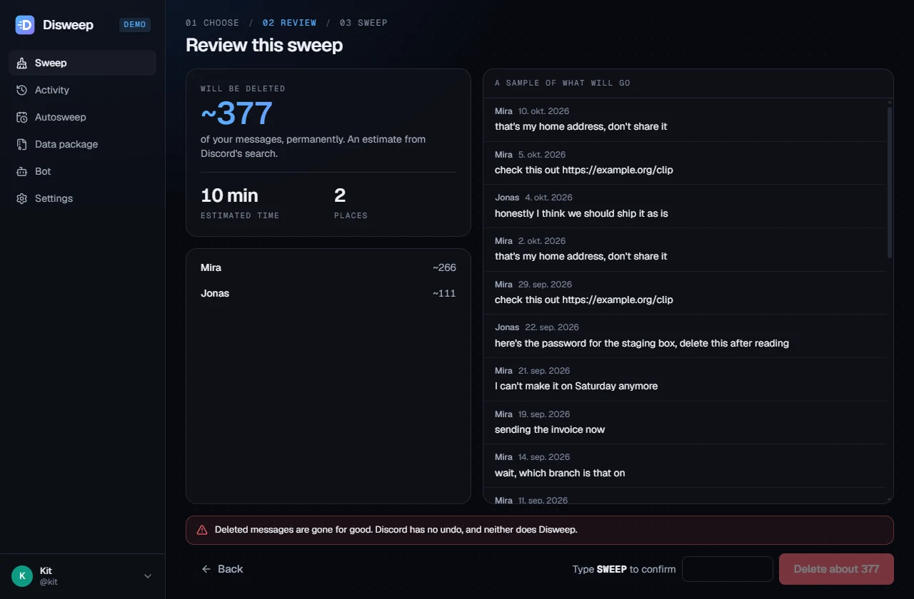
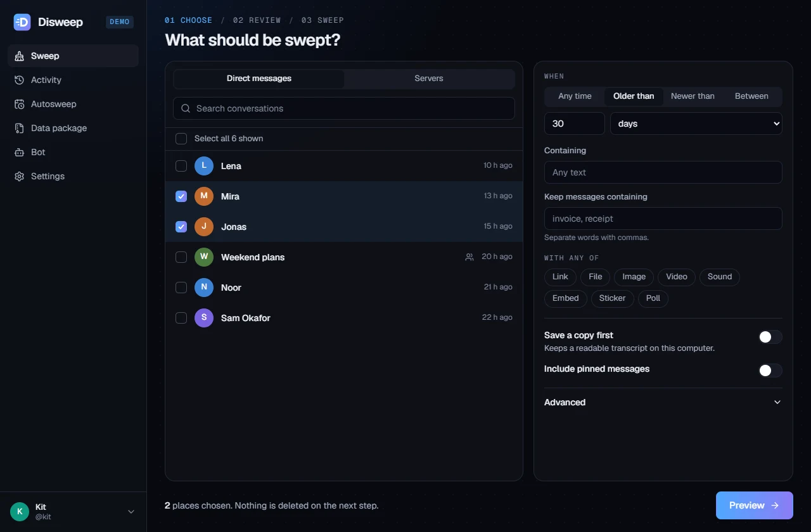
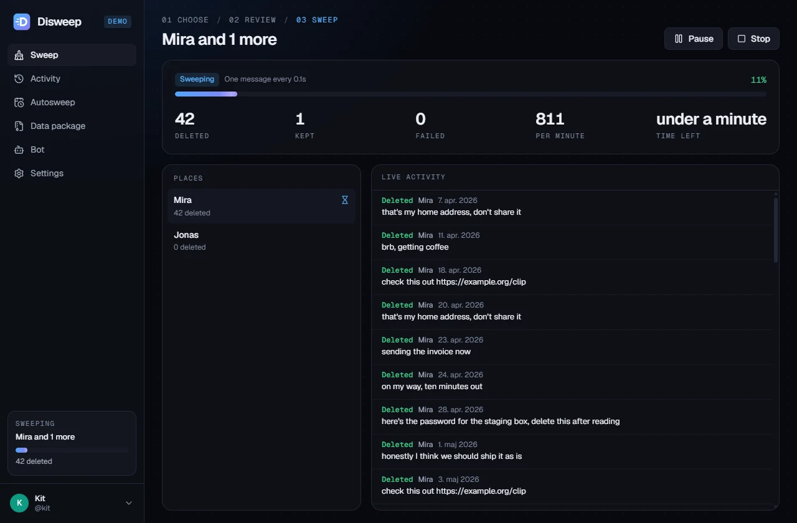
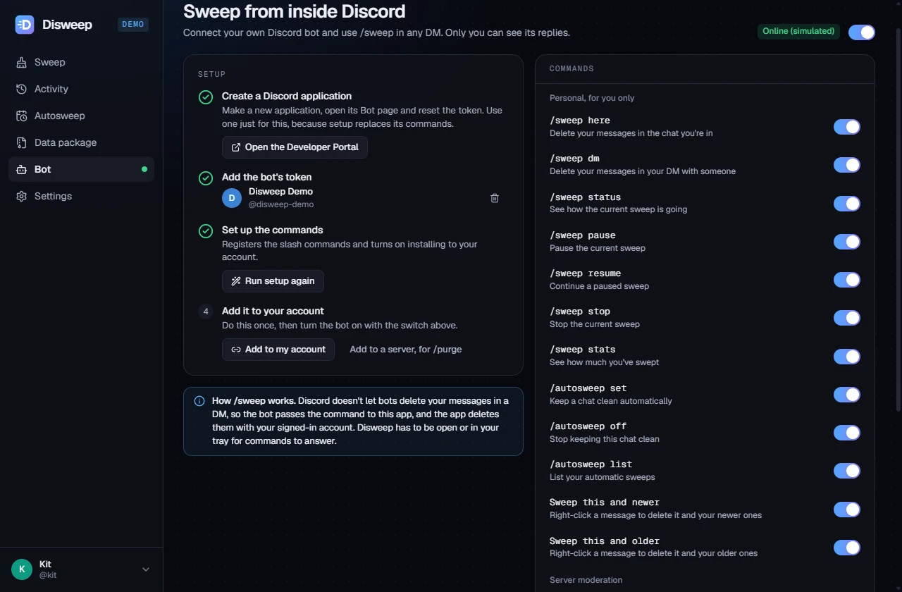
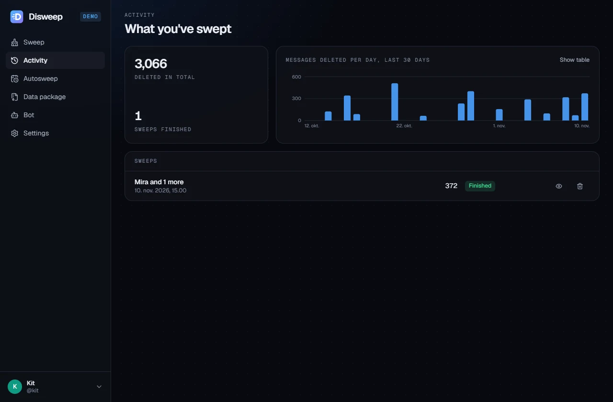
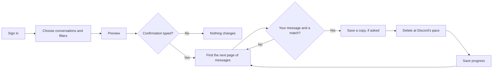

<div align="center">

<picture>
  <source media="(prefers-color-scheme: dark)" srcset="docs/assets/banner-dark.webp">
  
</picture>

<br>

**Find and permanently delete your own Discord messages, with a full preview and an explicit confirmation before anything changes.**

<br>

[](https://www.rust-lang.org)
[](https://tauri.app)
[](https://react.dev)
[](https://www.typescriptlang.org)
[](https://bun.sh)
[](https://biomejs.dev)
<br>
[](#install)
[](https://github.com/kaanxsrd/homebrew-tap)
[](https://github.com/kaanxsrd/scoop-bucket)
[](LICENSE)

**[Install](#install)** ·
**[Quick start](#quick-start)** ·
**[Sweeping](docs/sweeping.md)** ·
**[The bot](docs/bot.md)** ·
**[Data packages](docs/data-package.md)** ·
**[Changelog](CHANGELOG.md)** ·
**[Security](SECURITY.md)**

</div>

<br>



<table>
  <tr>
    <td width="50%"></td>
    <td width="50%"></td>
  </tr>
  <tr>
    <td align="center"><sub>Choose exactly what goes.</sub></td>
    <td align="center"><sub>Every message, live.</sub></td>
  </tr>
  <tr>
    <td width="50%"></td>
    <td width="50%"></td>
  </tr>
  <tr>
    <td align="center"><sub>Run <code>/sweep</code> inside any DM.</sub></td>
    <td align="center"><sub>Everything you've swept, and anything to resume.</sub></td>
  </tr>
</table>

> [!WARNING]
> A sweep **permanently deletes your messages**. Discord has no undo, and neither does Disweep. Read the preview, and turn on **Save a copy first** if you might want them back.

> [!CAUTION]
> Disweep automates a personal Discord account, which [Discord's Terms of Service](https://discord.com/terms) do not allow. Discord can suspend accounts for doing this, and you accept that risk by using it.

## Features

<table>
  <tr>
    <td width="50%" valign="top">

**Preview by default**<br>
See how many messages would go, how long it would take and a sample of them, before anything can be deleted.

</td>
    <td width="50%" valign="top">

**Explicit confirmation**<br>
Nothing starts until you type a confirmation word, so a stray click can't cost you a conversation.

</td>
  </tr>
  <tr>
    <td valign="top">

**Only ever your messages**<br>
The author of every message is checked immediately before it's deleted, even when Discord's search returned it. Bot replies to your commands are safe.

</td>
    <td valign="top">

**Sweeps that finish**<br>
Disweep moves through message IDs instead of search offsets, so it doesn't stop early when search lags or passes 10,000 results.

</td>
  </tr>
  <tr>
    <td valign="top">

**[A Discord bot built in](docs/bot.md)**<br>
Add your own bot and run `/sweep` inside any DM. Only you see the replies, and only your account can use it.

</td>
    <td valign="top">

**[Reach closed DMs](docs/data-package.md)**<br>
Import Discord's data package to delete messages in closed DMs and old conversations no scan can find.

</td>
  </tr>
  <tr>
    <td valign="top">

**Pick up where it stopped**<br>
Pause any time. Progress is saved, so a sweep can continue after a crash, a restart or a lost connection.

</td>
    <td valign="top">

**[Keep chats clean](docs/sweeping.md#autosweep)**<br>
Autosweep rules delete your messages once they pass an age you choose, from the tray.

</td>
  </tr>
  <tr>
    <td valign="top">

**Filter by anything**<br>
Dates, text, words to keep, regular expressions, links, files, images, stickers, polls, or a range between two messages.

</td>
    <td valign="top">

**A native program, and private**<br>
A small app for Windows and macOS. Your login stays in your system's credential store and only ever goes to Discord.

</td>
  </tr>
</table>

## Quick start

Download Disweep for your system from the [latest release](https://github.com/kaanxsrd/Disweep/releases/latest) and open it.

Sign in through Discord's own page, choose some conversations, and press **Preview**. Nothing is deleted until you've reviewed it and typed the confirmation.

Want a look first? The demo runs the real app against a simulated Discord, with no account and no network:

```sh
disweep --demo
```

## Install

| Platform             | Download or command                                                                              |
| -------------------- | ------------------------------------------------------------------------------------------------ |
| **Windows**          | [Installer or portable `.exe`](https://github.com/kaanxsrd/Disweep/releases/latest)              |
| **Windows** (Scoop)  | `scoop bucket add disweep https://github.com/kaanxsrd/scoop-bucket` then `scoop install disweep` |
| **macOS**            | [`.dmg`](https://github.com/kaanxsrd/Disweep/releases/latest), for Apple Silicon or Intel        |
| **macOS** (Homebrew) | `brew install --cask kaanxsrd/tap/disweep`                                                       |

Windows 10 or newer, and macOS 11 or newer, on x64 or arm64. Every release comes with checksums.

<details>
<summary><b>Opening an unsigned download</b></summary>

<br>

Releases are not code-signed. Windows may show **Windows protected your PC**, where **More info** then **Run anyway** continues. If Smart App Control is on, Windows blocks it without offering to continue, and [troubleshooting](docs/troubleshooting.md#smart-app-control-blocked-disweep) explains the choice. On macOS, after moving the app to Applications, clear the quarantine flag:

```sh
xattr -dr com.apple.quarantine /Applications/Disweep.app
```

Disweep receives your account token, so only run a copy you trust, and compare it with `checksums.txt` from the same release.

</details>

## How it works



<details>
<summary><b>What gets deleted, and what doesn't</b></summary>

<br>

| Item                    | Behavior                                                                       |
| ----------------------- | ------------------------------------------------------------------------------ |
| Your messages           | Deleted, if they match your filters                                            |
| Other people's messages | Never touched, except by `/purge`, which moderators run in their own servers   |
| Pinned messages         | Kept unless you include them                                                   |
| System messages         | Kept, because Discord doesn't allow deleting them                              |
| Archived threads        | Listed as failed, because Discord doesn't allow changes until they're reopened |

The [sweeping guide](docs/sweeping.md) covers every option.

</details>

## The bot

Connect a bot of your own from the **Bot** screen, and these work in any DM, group DM or server. Replies are private to you.

| Command                  | What it does                                                |
| ------------------------ | ----------------------------------------------------------- |
| `/sweep here`            | Delete your messages in the chat you're in                  |
| `/sweep dm`              | Delete your messages in your DM with someone, from anywhere |
| `/sweep status`          | See how the sweep is going, and pause, resume or stop it    |
| `/autosweep set`         | Keep this chat clean automatically                          |
| **Sweep this and newer** | Right-click a message to sweep from that point              |
| `/purge`                 | Bulk delete anyone's messages, for server moderators        |

Discord doesn't let bots delete your messages in a DM, so the bot passes the command to the app and the app does the deleting with your account. That means Disweep has to be open or in your tray. The [bot guide](docs/bot.md) has the setup steps and every command.

## Develop

Requires [Bun](https://bun.sh), [Rust](https://rustup.rs) and the [platform tools Tauri needs](https://tauri.app/start/prerequisites/), on Windows or macOS.

```sh
git clone https://github.com/kaanxsrd/Disweep && cd Disweep
bun install
bun run demo
bun run check
```

The tests run the real engine and bot against an in-memory Discord, so they need no token and make no Discord calls.

<details>
<summary><b>Scripts</b></summary>

<br>

| Command                                      | What it does                                               |
| -------------------------------------------- | ---------------------------------------------------------- |
| `bun run check`                              | Biome, TypeScript, rustfmt, Clippy and every test          |
| `bun run demo`                               | The app with hot reload against a simulated Discord        |
| `bun run test:e2e`                           | Drives the built app through its main flows (Windows)      |
| `bun run bindings`                           | Regenerates the TypeScript types from the Rust ones        |
| `bun scripts/build.ts`                       | Builds, smoke-tests and packages the app for this platform |
| `bun scripts/release.ts patch\|minor\|major` | Bumps the version, dates the changelog, commits and tags   |

</details>

<details>
<summary><b>Repository layout</b></summary>

<br>

```text
crates/
  disweep-core/       The engine, with no knowledge of windows
    api/              Discord client, rate limits and the transport boundary
    filter.rs         The final check on every message before it's deleted
    scan.rs           Finding candidates by search, history or data package
    engine/           Accounts, the job queue, the runner, previews and rules
    demo.rs           The in-memory Discord behind demo mode and the tests
    archive.rs        Saved copies and transcripts
    store.rs          Local history in SQLite
  disweep-bot/        Gateway connection and slash commands
src-tauri/            The desktop shell, tray, keychain and sign-in window
src/                  The interface: React, with types generated from Rust
tests/e2e/            Drives the real built app
packaging/            The logo that every icon is generated from
scripts/              Checks, builds, releases and package manager manifests
docs/                 Guides and README images
```

</details>

## Documentation

| Guide                                      | What's inside                                             |
| ------------------------------------------ | --------------------------------------------------------- |
| [Sweeping](docs/sweeping.md)               | Filters, how messages are found, archives, autosweep      |
| [The bot](docs/bot.md)                     | Setup, every command, and who can use it                  |
| [Data packages](docs/data-package.md)      | Getting your package and what it can reach                |
| [Troubleshooting](docs/troubleshooting.md) | Common problems and what to do about them                 |
| [Changelog](CHANGELOG.md)                  | What changed in each version                              |
| [Contributing](CONTRIBUTING.md)            | Setup, conventions and releases                           |
| [Security policy](SECURITY.md)             | How to report a vulnerability, and how logins are handled |

## Credits

Disweep was inspired by [Undiscord](https://github.com/victornpb/undiscord) by [Victornpb](https://github.com/victornpb) and its contributors. It's an independent program, written from scratch. [NOTICE](NOTICE.md) has the details.

## License

[GNU General Public License v3.0](LICENSE) © Vante. Disweep is free software: you can redistribute and modify it under the terms of the GPL, version 3. It comes with no warranty.

<div align="center">
<br>
<sub>Built for everyone who has ever said something they'd rather not keep.</sub>
</div>
