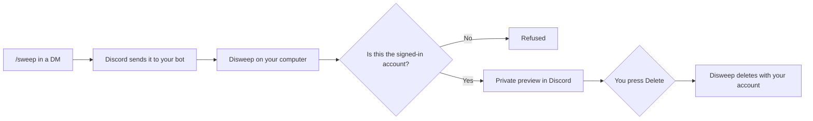

# The Discord bot

Connect your own Discord bot to run sweeps from inside Discord, including from a DM with someone else. Its replies are visible only to you.

## How it works

Discord gives bots no way to delete a person's messages in a DM, so the bot is a remote control for the app:

That has two consequences:

- **Disweep has to be running** on your computer, open or in the tray. Otherwise Discord says the application did not respond.
- **You need to be signed in to Disweep** with the same account that runs the commands.

## Setting it up

Everything is on the **Bot** screen. You only do this once.

1. **Create an application** in the [Discord Developer Portal](https://discord.com/developers/applications). Use one just for this, because setup replaces any commands it already has.
2. **Add the bot's token.** On the application's **Bot** page, choose **Reset Token**, copy it, and paste it into Disweep. It's stored in your system's credential store.
3. **Set up the commands.** Disweep registers the slash commands and turns on installing to your account.
4. **Add it to your account** with the button in Disweep, which opens Discord's install page.
5. **Turn the bot on** with the switch at the top of the screen.

If Disweep says Discord didn't accept account installs, open the application's **Installation** page in the portal, tick **User Install**, and run setup again.

## Commands

Personal commands work in servers, in the bot's own DM, and in any DM or group DM. You can switch off any command on the Bot screen.

| Command           | What it does                                                      |
| ----------------- | ----------------------------------------------------------------- |
| `/sweep here`     | Delete your messages in the chat you're in                        |
| `/sweep dm`       | Delete your messages in your DM with someone, from anywhere       |
| `/sweep status`   | See how the current sweep is going                                |
| `/sweep pause`    | Pause the current sweep                                           |
| `/sweep resume`   | Continue a paused sweep                                           |
| `/sweep stop`     | Stop the current sweep                                            |
| `/sweep stats`    | See how much you've swept                                         |
| `/autosweep set`  | Keep this chat clean by deleting your messages past a certain age |
| `/autosweep off`  | Stop keeping this chat clean                                      |
| `/autosweep list` | List your automatic sweeps                                        |

`/sweep here` and `/sweep dm` accept `contains`, `older_than`, `newer_than`, `has`, `limit` and `include_pinned`. Lengths of time look like `30d`, `2h`, `6mo` or `1y`.

Right-click a message and open **Apps** for two more:

| Menu item            | What it does                                 |
| -------------------- | -------------------------------------------- |
| Sweep this and newer | Delete this message and your newer ones here |
| Sweep this and older | Delete this message and your older ones here |

Every sweep shows a private preview with **Delete** and **Cancel** buttons first. Discord stops letting a bot update a reply after 15 minutes, so for longer sweeps use `/sweep status` or watch the app.

## Moderating a server with /purge

`/purge` is different from the personal commands. It uses the bot's own permissions to delete **anyone's** messages in a server channel, so it's meant for moderators. To use it, add the bot to the server with the button on the Bot screen.

| Option        | What it does                                           |
| ------------- | ------------------------------------------------------ |
| `count`       | How many messages to delete, up to 1,000               |
| `user`        | Only this person's messages                            |
| `contains`    | Only messages containing this text                     |
| `has`         | Only messages with a link, file, image and so on       |
| `include_old` | Also delete messages over two weeks old, one at a time |

Both the person running it and the bot need the **Manage Messages** permission. Filtering by `contains` or `has` needs the **Message Content Intent**, which setup turns on where Discord allows it.

## Who can use it

- Personal commands only work for the account signed in to your copy of Disweep. Anyone else gets a refusal, even if they install your bot.
- Confirmation buttons only work for the person who ran the command, and only once.
- Turning off **Public Bot** on the application's **Bot** page stops anyone else from installing it at all.
